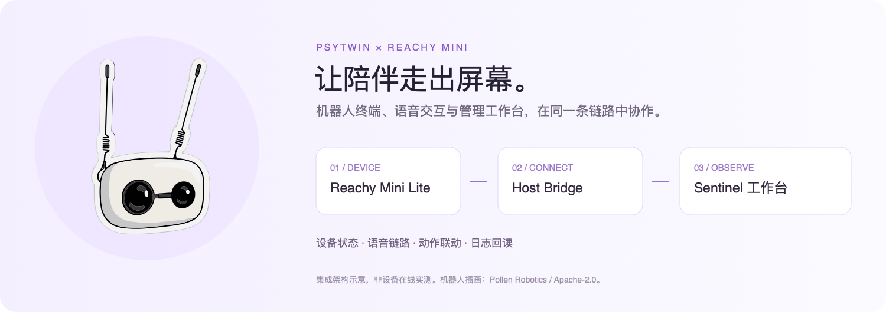
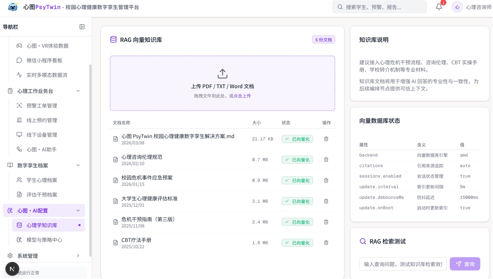
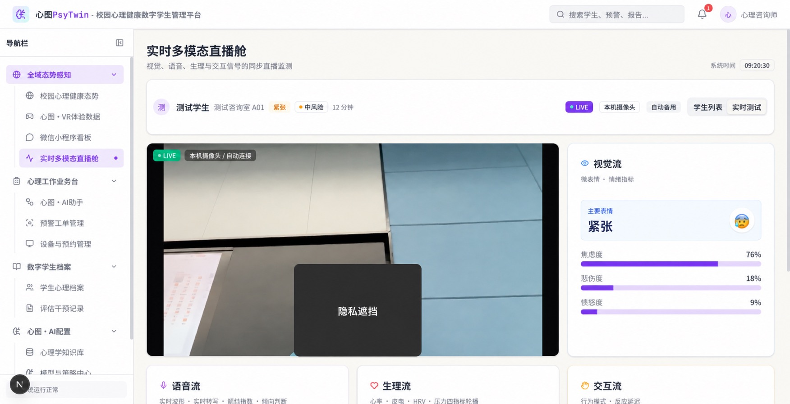
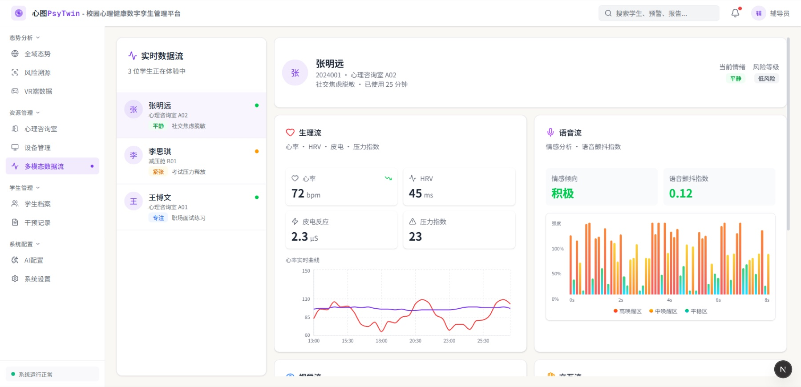

# PsyTwin Sentinel · 心图·网络

[简体中文](README.md) | **English**

A campus mental health digital twin management platform for counseling centers and student advisors. Sentinel brings multimodal monitoring, student profiles, risk alerts, intervention records, and service appointments into one workspace.



*Integration illustration, not a photo of our deployed device or live acceptance evidence. Robot artwork: [Pollen Robotics](https://github.com/pollen-robotics/reachy_mini/blob/54f5efcfa8c228c674d97de2f85996515143b8ce/ts/host/src/assets/reachy-standard.svg), [Apache-2.0](docs/images/third-party/reachy-mini-LICENSE.txt); project integration layout added.*

## System preview

### RAG knowledge base



### Live multimodal monitoring



### Multimodal data analysis



*Screenshots from local demo runs at different stages of development. The RAG screenshot shows an earlier management interface; the current implementation integrates LightRAG. Displayed metrics are not model performance evaluation results.*

## Features

| Module | Purpose |
| --- | --- |
| Live multimodal monitoring | Bring camera, speech, and physiological signals together with monitoring status and analysis results. |
| Student digital twin profiles | Review assessments, counseling and behavioral records through student profiles and timelines. |
| Risk alerts and interventions | Track risk indicators, follow-up records, and intervention workflows. |
| Devices and appointments | Switch between scheduling, therapeutic spaces, and device status from one entry point. |
| PsyTwin AI Assistant | Coordinate AI conversations through OpenClaw, with optional LightRAG retrieval context. |
| Pet AI management | Student pet profiles, two-layer AI collaboration, and Reachy Mini device debugging. |
| LightRAG knowledge base | Access document management, knowledge graphs, and retrieval-based Q&A within the management console. |

## Stack

- **Web**: Next.js 16, React 19, TypeScript, Tailwind CSS 4, shadcn/ui, and Recharts.
- **Data**: PostgreSQL, pgvector, Prisma, and Redis.
- **Integrations**: OpenClaw Gateway and LightRAG; `/api/pocket` serves the WeChat mini program.

## Run locally

Requires **Node.js 20.9+**, PostgreSQL with the **pgvector** extension, and Redis. Deploy OpenClaw and LightRAG separately if you need their features.

```bash
git clone https://github.com/XingjianTian/PsyTwin-Sentinel.git
cd PsyTwin-Sentinel
npm install
cp .env.example .env
```

Set `DATABASE_URL`, `JWT_SECRET`, and the required Redis connection settings in `.env`. For AI features, provide your own service endpoints and credentials. Replace the template's LightRAG addresses with your instance's addresses as well.

```bash
npx prisma migrate deploy
npx prisma generate
npm run seed:incremental
npm run dev
```

Open [localhost:3000](http://localhost:3000). The incremental seed adds core configuration without creating login accounts. For a fresh demo database, run `npx tsx prisma/seed/03-users.ts` to create demo users; see that script for account details.

See the [Prisma guide](prisma/README.md) and [cloud deployment guide](docs/CLOUD_DEPLOYMENT.md) for database initialization and deployment details.

## Documentation

The detailed guides below are currently in Chinese.

- [Product requirements](docs/PRD.md)
- [Cross-client API contract](docs/api_contract.md)
- [Reachy Mini setup and live integration](docs/REACHY_MINI_SETUP_GUIDE.md)
- [LightRAG integration](docs/LIGHTRAG_INTEGRATION.md)
- [Pet system architecture](docs/pet-system-architecture.md)
- [Changelog](docs/CHANGELOG.md)

## Related projects

- [PsyTwin-Pocket](https://github.com/XingjianTian/PsyTwin-Pocket): WeChat mini program for students and teachers, with a community feed, virtual pets, AI chat, and appointments.
- [PsyTwin-Companion](https://github.com/XingjianTian/PsyTwin-Companion): Multimodal collection and terminal integration.
- [PsyTwin-OpenClaw](https://github.com/XingjianTian/PsyTwin-OpenClaw): AI agent orchestration.
