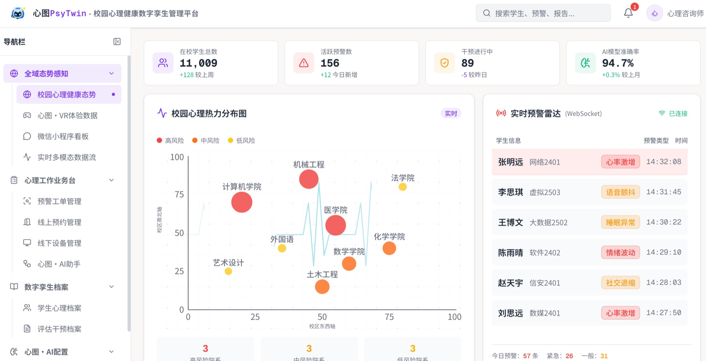
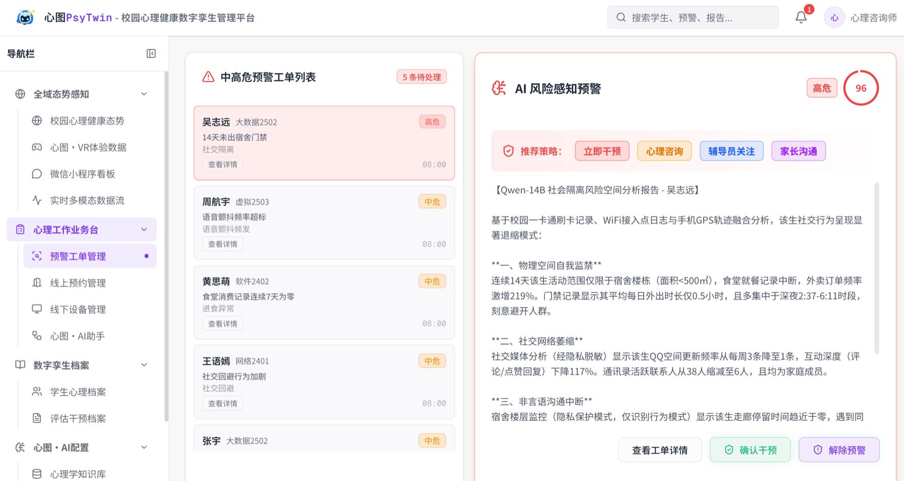

# PsyTwin Sentinel · 心图·网络

**简体中文** | [English](README.en.md)

校园心理健康数字孪生管理平台，面向心理中心与辅导员，将多模态监测、学生档案、风险预警、干预记录与服务预约汇集在同一工作台。



*本地项目历史运行演示截图。截图中的指标用于展示界面，不代表模型性能评测结果。*

<details>
<summary>查看风险预警界面</summary>



*本地项目历史运行演示截图。指标不代表模型性能评测结果，数据与设备状态以实际接入为准。*

</details>

## 核心能力

| 模块 | 用途 |
| --- | --- |
| 实时多模态直播舱 | 汇集摄像头、语音与生理信号，展示监测状态和分析结果。 |
| 学生心理孪生档案 | 整合测评、咨询与行为记录，查看学生画像和时间线。 |
| 风险预警与干预 | 管理风险线索、跟进记录和干预流程。 |
| 设备与预约管理 | 在同一入口切换预约排期、疗愈空间与设备状态。 |
| 心图·AI助手 | 通过 OpenClaw 编排 AI 对话，并可附加 LightRAG 检索上下文。 |
| LightRAG 知识库 | 在管理台中接入文档管理、知识图谱与检索问答。 |

## 技术栈

- **Web**：Next.js 16、React 19、TypeScript、Tailwind CSS 4、shadcn/ui、Recharts。
- **数据**：PostgreSQL、pgvector、Prisma、Redis。
- **集成**：OpenClaw Gateway、LightRAG；通过 `/api/pocket` 为微信小程序提供接口。

## 本地启动

需要 **Node.js 20.9+**、支持 **pgvector** 扩展的 PostgreSQL，以及 Redis。OpenClaw 和 LightRAG 按所需功能单独部署。

```bash
git clone https://github.com/XingjianTian/PsyTwin-Sentinel.git
cd PsyTwin-Sentinel
npm install
cp .env.example .env
```

在 `.env` 中设置 `DATABASE_URL`、`JWT_SECRET` 及所需 Redis 连接项；使用 AI 功能时填写自己的服务地址和凭据。模板内的 LightRAG 地址也需改成你的实例地址。

```bash
npx prisma migrate deploy
npx prisma generate
npm run seed:incremental
npm run dev
```

打开 [localhost:3000](http://localhost:3000)。增量种子只补齐核心配置，不创建登录账号；全新演示数据库可运行 `npx tsx prisma/seed/03-users.ts` 创建演示用户，账号见该脚本。

数据库初始化与部署细节见 [Prisma 指南](prisma/README.md) 和 [云部署指南](docs/CLOUD_DEPLOYMENT.md)。

## 文档

- [产品需求](docs/PRD.md)
- [跨端 API 契约](docs/api_contract.md)
- [LightRAG 接入](docs/LIGHTRAG_INTEGRATION.md)
- [心宠系统架构](docs/pet-system-architecture.md)
- [更新记录](docs/CHANGELOG.md)

## 关联项目

- [PsyTwin-Pocket](https://github.com/XingjianTian/PsyTwin-Pocket)：面向学生与教师的微信小程序，提供心墙、心宠、AI 对话与预约入口。
- [PsyTwin-Companion](https://github.com/XingjianTian/PsyTwin-Companion)：多模态采集与终端接入。
- [PsyTwin-OpenClaw](https://github.com/XingjianTian/PsyTwin-OpenClaw)：AI 智能体编排。
